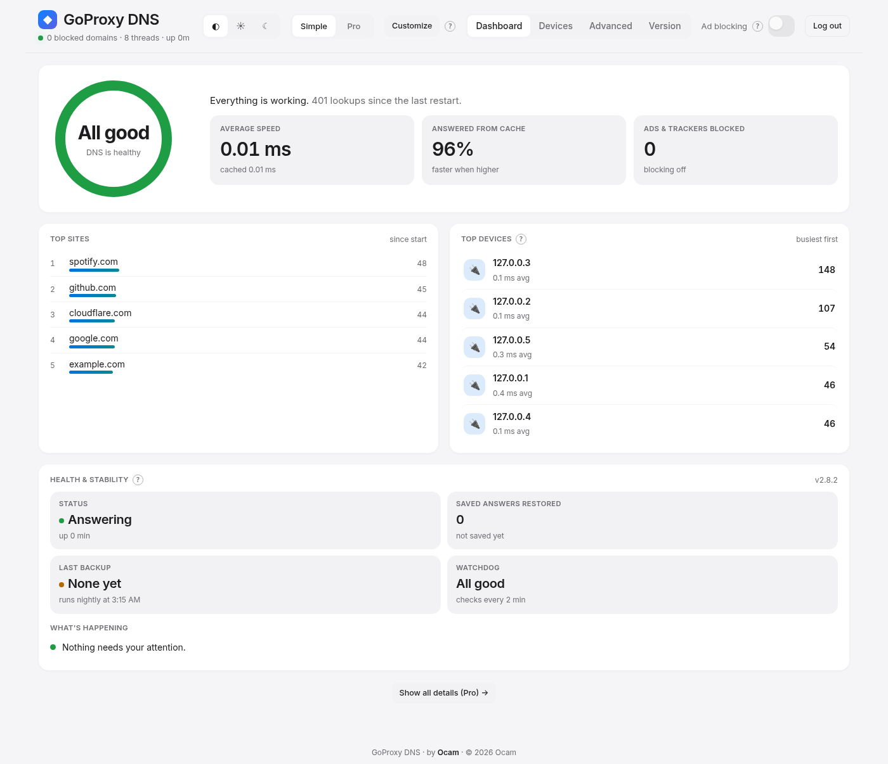
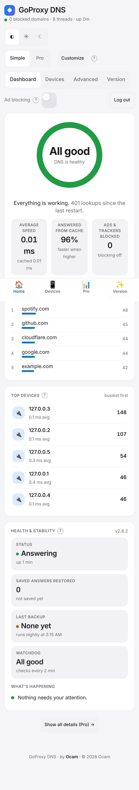

<!-- Copyright (c) 2026 Ocam -->
# GoProxy DNS 2.8.2 — by Ocam

Fast, caching, ad-blocking home DNS server with a built-in dashboard.

## Features
- Encrypted upstreams (DoH/DoT) with parallel racing and plain-DNS fallback
- Large in-memory cache, saved every 10 min and on shutdown, restored on start (warm restarts)
- Blocklists, per-device stats and Devices explorer
- `.home` local names: automatic (from router reverse lookups) plus a manual list
- Stability: Docker HEALTHCHECK, panic recovery, watchdog and nightly-backup scripts
- Dashboard: Simple and Pro modes, light/dark, phone layout with bottom tabs, customizable cards with reset

## Screenshots
| Simple | Pro | Phone |
|---|---|---|
|  |  |  |

## Install (Docker)
```sh
docker build -f docker/Dockerfile -t goproxy:2.8.2 .
# or: docker load -i goproxy-v2.8.2-amd64.tar
docker compose -f docker/docker-compose.yml up -d
```
Open `http://<server-ip>:8053`, set an admin password, then point your router's DHCP DNS at the server.

## Common flags
| Flag | Default | Meaning |
|---|---|---|
| `-dns-addr` | `:53` | DNS listen address |
| `-http-addr` | `:8053` | Dashboard/API address |
| `-profile` | | Performance preset (e.g. `max`) |
| `-cache-mb` | | Cache memory budget |
| `-min-ttl` | | Minimum cache TTL (e.g. `60s`) |
| `-plain-fallback` | | Fall back to plain DNS if encrypted upstreams fail |
| `-parallel-all` | | Race all upstreams |
| `-ptr-server` | `off` | Router IP for automatic `.home` names |
| `-version` | | Print version |

Run `goproxy -h` for the full list.

## Licensing
GoProxy DNS is dual-licensed:

- **Free/open source:** [GNU AGPL-3.0-only](LICENSE). You may use, modify and share it; if you distribute it or run a modified version as a network service, you must provide the corresponding source under the AGPL.
- **Commercial license:** available from Ocam for use without AGPL obligations (e.g. closed-source products or hosted services). See [COMMERCIAL-LICENSE.md](COMMERCIAL-LICENSE.md). Contact: **Ocam.inc@gmail.com**

Contributions require signing the [CLA](CLA.md) (see [CONTRIBUTING.md](CONTRIBUTING.md)).

Copyright (c) 2026 Ocam.
